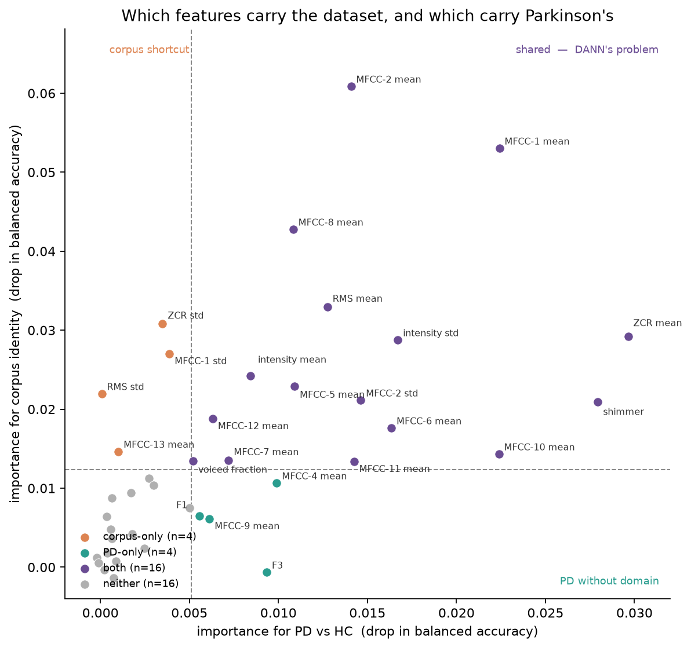
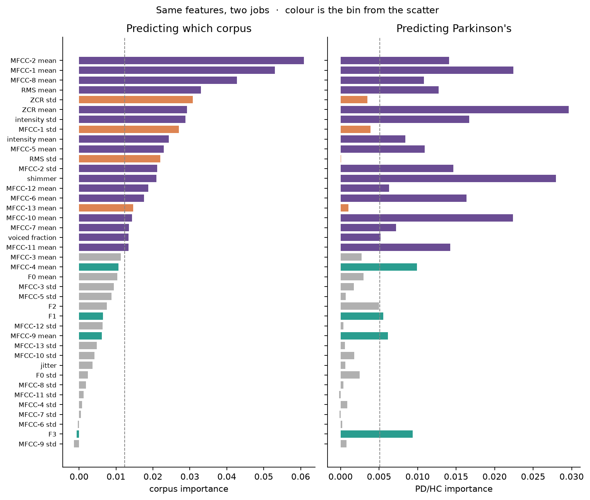
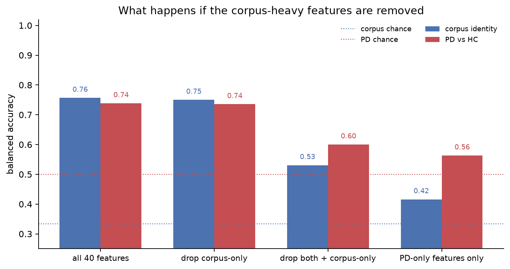
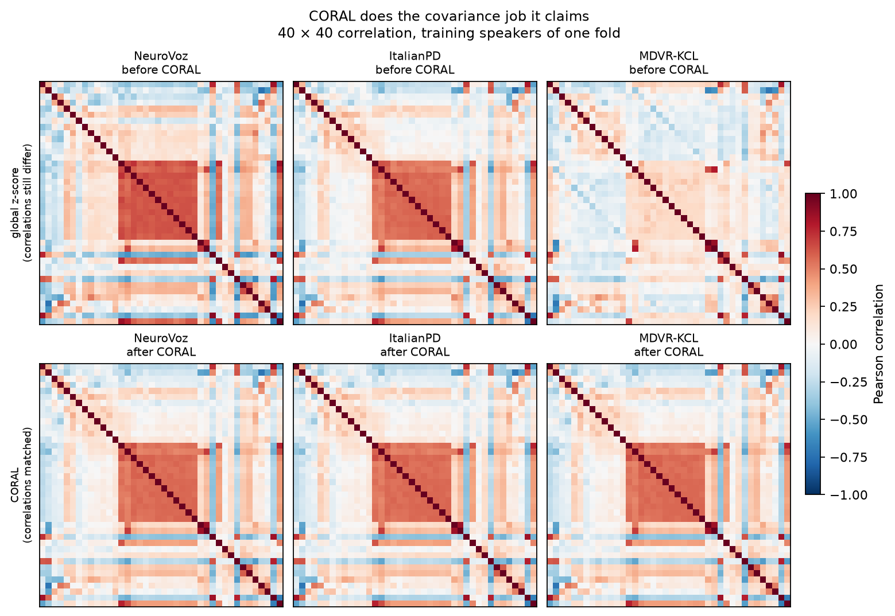
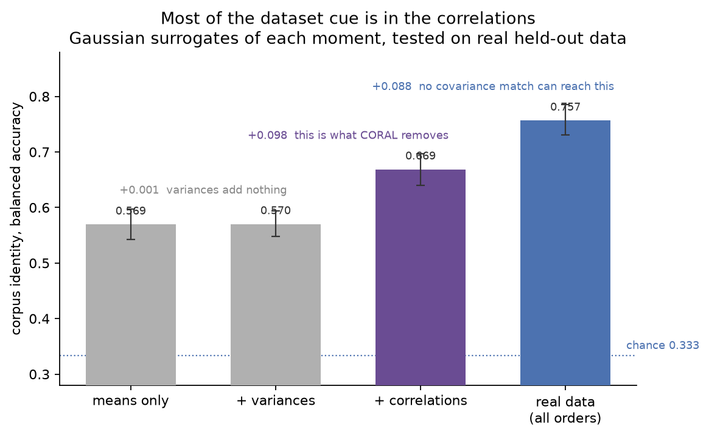
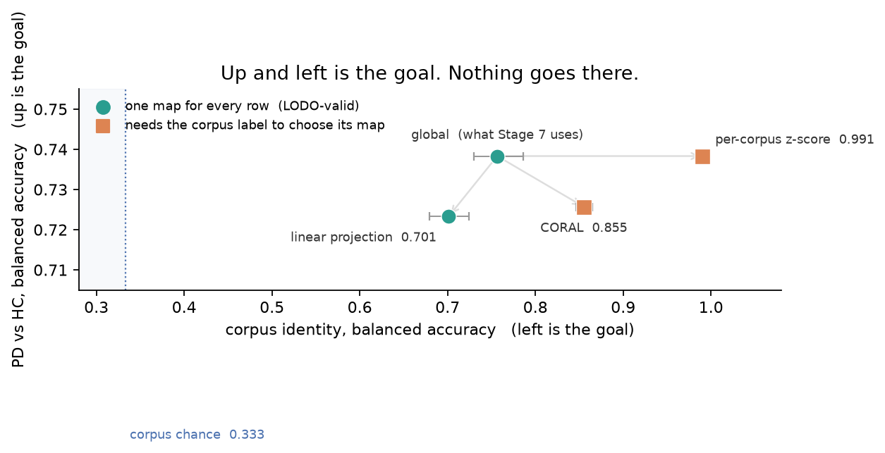
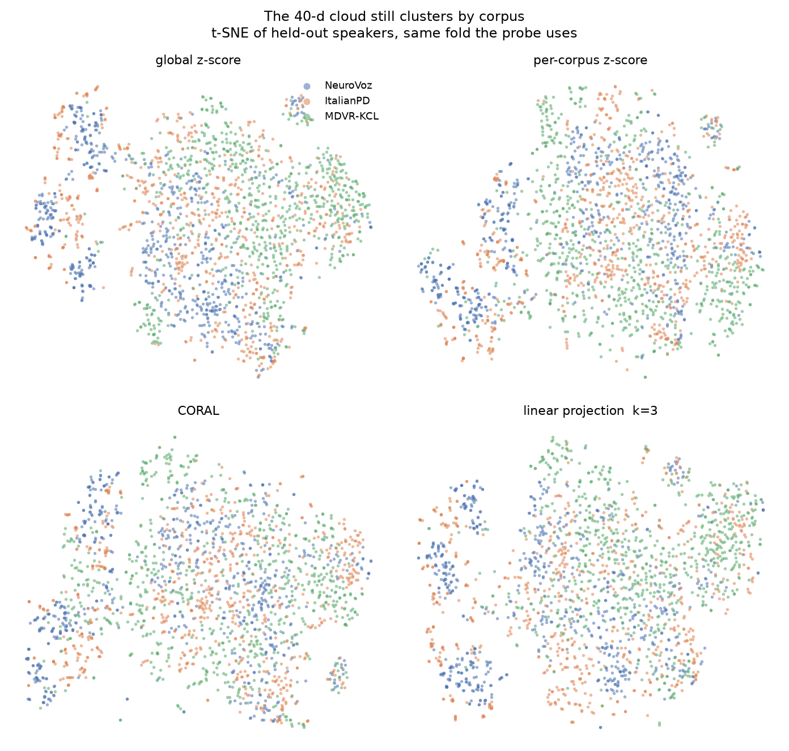

# Ablation — can batch correction replace DANN?

DH307 Subtopic 4 · Corpus- and Language-Invariant Parkinson's Detection from Speech

Stage 5 showed that from 40 handcrafted features, **corpus identity is easier
to predict than Parkinson's**. This ablation asked whether a non-adversarial
fix — centre each dataset, or drop the columns that name it — already removes
that shortcut. It does not. Per-corpus z-score makes corpus identity *easier*
(0.757 → 0.991) and leaves PD/HC untouched. The four columns that are
corpus-only can be dropped with no effect. The cue lives in **16 features
that also carry the diagnosis**; cutting those takes PD from 0.738 to 0.600
with it.

The mainline is unchanged: `norm=global`, all 40 features, Stage 7 baseline
then DANN. Removing the corpus is the adversary's job.

A follow-up run took this further and is reported in the second half of this
file. Second-order structure turns out to carry most of the corpus cue, yet
matching it exactly — CORAL — makes corpus identity *easier* too (0.757 →
0.855), and deleting the linearly corpus-predictive directions leaves it at
0.701 after removing nine of forty dimensions. The cue is non-linear, no
shallow method clears the bar, and — measured with task, channel and age each
held fixed in turn — none of those three is what makes the corpora separable.

**In:** `data/processed/features/handcrafted_duration.npy`, Stage 6 splits
**Out:** `experiments/corpus_norm_ablation/`,
`notebooks/figures/featimp_*.png`, `notebooks/figures/ablation_*.png`
**Code:** `src/features/store.py` (`corpus` scope), `src/features/coral.py`,
`src/features/project.py`, `scripts/probe_normalisation.py`,
`scripts/probe_feature_importance.py`, `scripts/visualise_ablation.py`,
`src/training/classical.py`

---

## Why this was worth measuring

A model trained without a domain penalty has an easier wrong problem
available than the one it is meant to solve. The tempting shortcut is to
z-score each corpus, or to throw away the features a tree uses to name the
dataset, and then train Parkinson's on what remains.

Both are legal as **named controls**. Neither is allowed on the main feature
path (`PIPELINE.md` invariant 2). This run is that control, on duration
handcrafted features, with the same gradient-boosted thermometer Stage 5
used. No MLP, no DANN, no second cache.

---

## Per-corpus z-score

Called "mean-only" when this section was written, which was wrong:
`fit_stats` stores `(mean, std)` per dataset and `apply` divides by the
std, so this equalises per-corpus means **and marginal variances**. The
distinction matters — it means the corpus correlation matrices survive this
transform untouched. See the follow-up below.

Statistics are fitted on training speakers only. Mixed test speakers of
corpus *d* use *d*'s training mean and std. Strict LODO cannot see the
held-out corpus: those rows fall back to pooled source stats (`__all__`),
not to identity `(0, 1)`.

Mixed probe, 40k segments, 216 speakers, speaker-grouped 5-fold CV:

| scope | corpus BA | chance | PD/HC BA | chance |
|---|---|---|---|---|
| none / global | 0.757 | 0.333 | 0.738 | 0.500 |
| speaker | 0.327 | 0.333 | 0.500 | 0.500 |
| utterance | 0.332 | 0.333 | 0.469 | 0.500 |
| **corpus** | **0.991** | 0.333 | **0.738** | 0.500 |

Speaker and utterance scopes still delete the target, as Stage 5 measured.
Corpus z-score does not. It equalises first-order shifts, and what remains —
covariance, task mix, language, channel — becomes easier to split on.
The follow-up below narrows that list: task mix contributes nothing
measurable, and matching the recording channel does not lower corpus
separability either.

Strict LODO (fit on the other two corpora; `held_out_in_stats=False`):

| held out | global PD/HC | corpus PD/HC |
|---|---|---|
| ItalianPD | 0.591 | **0.504** |
| MDVR-KCL | 0.599 | 0.616 |
| NeuroVoz | 0.521 | 0.510 |

Train is centred *per source corpus*; the target is scaled with pooled
source `__all__`. That mismatch takes ItalianPD to chance. It is what
strict LODO *is* for this method, not a fallback bug.

On Stage 6 mixed fold 0 (22 test speakers, speaker-pooled GBT) test BA is
**0.818** and AUC **0.826** under both `global` and `corpus`. Per-corpus
scores are identical. ItalianPD at 1.00 on a handful of speakers is the
age confound in a thin fold, present under both scopes.

Do not treat `norm=corpus` as a cleaned dataset.

---

## Feature importance

If 0.991 were three noisy columns, Stage 7 could mask them. It is not.

Same 40k sample, seed 0, global norm fitted per fold. Importance is the
drop in balanced accuracy when that column is shuffled on the held-out
fold (5 repeats), then averaged across folds. A feature is “high” if it
sits above the median of its target.

| bin | n | meaning |
|---|---|---|
| corpus-only | 4 | names the dataset, not the diagnosis |
| PD-only | 4 | names the diagnosis, not the dataset |
| both | 16 | names both — DANN's problem |
| neither | 16 | below both medians |

**Corpus-only:** ZCR std, MFCC-1 std, RMS std, MFCC-13 mean.

**PD-only:** MFCC-4 mean, F1, MFCC-9 mean, F3.

**Both:** MFCC-1, -2, -8 means, ZCR mean, RMS mean, intensity, shimmer.
The strongest corpus features are also among the strongest PD features.

Re-score after dropping bins:

| subset | n | corpus BA | PD/HC BA |
|---|---|---|---|
| all 40 | 40 | 0.757 | 0.738 |
| drop corpus-only | 36 | 0.750 | 0.735 |
| drop both + corpus-only | 20 | 0.531 | 0.600 |
| PD-only only | 4 | 0.416 | 0.563 |

Dropping orange does nothing. Cutting the shared 16 takes pathology with
the domain. Stage 7 should keep all 40 columns.

---

## Figures

Use these three for the first half. They are in `notebooks/figures/` and
`experiments/corpus_norm_ablation/figures/`. The CORAL / moment-ladder /
t-SNE panels are under **Follow-up** below.

### 1. One point per feature



Dashed lines are the two medians. **Orange** (upper left): corpus shortcut.
**Teal** (lower right): PD without domain. **Purple** (upper right): shared.
**Grey**: weak on both.

*Say this:* almost every feature that helps PD sits in the purple quadrant.
The model cannot be given “PD features” that are not also dataset features.

### 2. Same features, two jobs



Sorted by corpus importance; colour is the bin from the scatter.

*Say this:* ZCR mean and shimmer are mid-pack for naming the corpus and
top-pack for naming Parkinson's. MFCC-2 mean is the opposite — strongest
corpus cue, only moderate for PD. Formants (F1, F3) are the rare teal
exceptions.

### 3. What dropping those bins does



Dotted lines are chance (0.33 corpus, 0.50 PD).

*Say this:* the first two groups barely move, so the four orange columns
were never the problem. The third group is the cost of deleting the shared
subspace: corpus falls, and PD falls with it. That is why a domain
adversary has to *keep* PD while forgetting corpus, rather than us dropping
columns.

---

## What this does not decide

- It does not say DANN will work. It says shallow mean correction and
  column-dropping will not.
- Mixed fold 0 is one 22-speaker test set. Per-corpus numbers there are
  not a result; Stage 8 still pools out-of-fold across all ten mixed
  configs.
- Only duration + handcrafted was probed *here*. The follow-up below adds
  `duration_100` and mean-pooled Mel; utterance under `corpus` scope is
  still unmeasured and, given `duration_100` at 1.000, not worth a run.
- Trees, not the MLP. The thermometer is the number the MLP should land
  near, not a substitute for Stage 7.

---

## Follow-up: how much is second-order, and does anything shallow remove it?

The mean/std run above left one question open — what the residual cue *is* —
and one answer implied but untested: that a stronger moment-matching method
might remove it. Both are now measured. Plan and kill criteria were written
before the runs, in `experiments/corpus_norm_ablation/PLAN_second_order.md`.

**The result in one line:** second-order structure carries most of the corpus
cue, and removing second-order structure does not remove the corpus cue.
Those are not contradictory, and the reason they are not is the finding.

**In:** `handcrafted_duration.npy`, `handcrafted_duration_100.npy`,
`mel_duration.npy`, Stage 6 splits — no new cache
**Out:** `experiments/corpus_norm_ablation/followup_summary.csv`,
`moment_ladder_r1.csv`, `probe_mixed_r*.csv`, `probe_lodo_r*.csv`,
`notebooks/figures/followup_methods.png`,
`notebooks/figures/ablation_{moment_ladder,coral_corr,methods,tsne}.png`
**Code:** `src/features/project.py`, `src/features/coral.py`,
`scripts/probe_moment_ladder.py`, `scripts/summarise_followup.py`,
`scripts/visualise_ablation.py`, new flags on `scripts/probe_normalisation.py`

---

### First, two corrections to how the run above was described

`fs.fit_stats(..., "corpus")` stores `(mean, std)` per dataset and `apply`
divides by the std. So `norm=corpus` was never mean-only: it equalised
per-corpus **means and marginal variances**. Correlation is invariant to a
per-column positive-scale affine map, so each corpus's correlation matrix came
through that transform **exactly unchanged**. The residual second-order piece is
therefore precisely the three correlation matrices, measured here after
`norm=corpus`:

| pair | off-diagonal Frobenius | max abs difference |
|---|---|---|
| ItalianPD vs MDVR-KCL | 8.45 | 0.61 |
| ItalianPD vs NeuroVoz | 4.21 | 0.38 |
| MDVR-KCL vs NeuroVoz | 10.76 | 0.87 |

Mean absolute excess kurtosis also differs — 5.80 / 2.58 / 2.94 — so second-order
and higher-order channels are both live.

Second, `norm=corpus` and CORAL both need a row's **corpus label at apply time**
to choose its map. They are domain-*conditional* transforms, not domain removal.
A single global map — a linear projection, or DANN's encoder — is a different
class of method, and only that class produces a corpus score comparable to
0.757 or a strict-LODO number at all:

| method | corpus label at apply time? | comparable to 0.757? | strict LODO? |
|---|---|---|---|
| `global` | no | yes (reference) | yes |
| `corpus` z-score | **yes** | no | no — pooled fallback only |
| CORAL | **yes** | no | no — pooled fallback only |
| linear projection | no | yes | yes |
| DANN | no | yes | yes |

That is why `norm=corpus` put ItalianPD at 0.504 under strict LODO. It is not a
fallback bug and not bad luck: the method has no defined behaviour on a corpus
it has not seen.

### The reference, with an interval this time

Speaker-grouped 5-fold, 40k segments, 1000 bootstrap resamples **over speakers**
— not segments, because a speaker contributes thousands of correlated windows and
at `duration` adjacent windows share half their audio.

| scope | corpus BA | PD/HC BA |
|---|---|---|
| global | 0.757 [0.730, 0.786] | 0.738 [0.704, 0.771] |
| corpus | 0.991 [0.988, 0.993] | 0.738 [0.702, 0.771] |

The corpus half-width is 0.028; the **PD/HC half-width is 0.034**, above the
0.03 the plan set as its own stop threshold. So every PD/HC difference below
about 0.035 in this section is not readable, and none is claimed as one. The
corpus numbers are the load-bearing ones.

### Moment ladder — how much of the cue is second-order

Real data is replaced by a Gaussian surrogate carrying only a chosen rung's
moments, fitted on training speakers, trained on, and tested on the **real**
held-out fold. Corpus BA, chance 0.333:

| rung | contains | real test | surrogate test | share of the 0.757 span |
|---|---|---|---|---|
| L0 | per-corpus means | 0.569 [0.542, 0.598] | 0.573 | 0.56 |
| L1 | + marginal variances | 0.570 [0.548, 0.593] | 0.872 | 0.56 |
| L2 | + correlations | 0.669 [0.640, 0.697] | 0.874 | 0.79 |
| L3 | real data, all orders | 0.757 [0.730, 0.786] | — | 1.00 |
| L2z | correlations alone, in the `norm=corpus` space | 0.591 [0.574, 0.607] | 0.677 | 0.39 of 0.991 |

Three things follow.

**Marginal variances carry nothing.** L1 − L0 = +0.001. Per-corpus standard
deviations add no corpus information beyond the means. That is exactly what
`norm=corpus` equalises on top of the means — so it spent its effort on a
component with no incremental content, which is why corpus identity did not fall.

**Correlations carry a lot.** L2 − L1 = +0.098, well past the 0.03 the plan set
as CORAL's kill threshold, and L2 reaches 0.79 of the chance-to-0.757 span,
past the 0.70 authorisation threshold. So CORAL was authorised on both
pre-registered criteria. The prediction recorded before the run put L2 at
0.55–0.68 of the span; 0.79 is above that. Correlations carry more than
expected.

**About a fifth of the cue is strictly above second order.** 0.757 − 0.669 =
0.088 BA. No covariance matching of any kind can reach that part. And in the
`norm=corpus` space, correlations alone reach 0.591 against the observed 0.991 —
only 39% — so most of the 0.991 was never second-order to begin with.

### CORAL — authorised, and it failed

Per-corpus centring, whitening by the corpus's own training covariance,
recolouring to the pooled training covariance. `coral.verify` asserts the
per-corpus covariances match the reference on the fitted set, so the method did
do what it claims.

| method | corpus BA | PD/HC BA |
|---|---|---|
| global | 0.757 [0.730, 0.786] | 0.738 [0.704, 0.771] |
| CORAL | **0.855 [0.846, 0.865]** | 0.726 [0.690, 0.758] |

Corpus identity got **easier**, by 0.098. Strict LODO PD/HC under CORAL is
ItalianPD 0.515, MDVR-KCL 0.626, NeuroVoz 0.520, against the `global` reference
of 0.591 / 0.599 / 0.521 — one corpus of three improved, so it fails the
promotion bar on the numbers as well as by construction.

**This is the section's central result.** Both domain-conditional maps move
corpus identity the wrong way:

| transform | what it equalises | corpus BA |
|---|---|---|
| none / global | — | 0.757 |
| per-corpus z-score | means, marginal variances | 0.991 |
| CORAL | means, full covariance | 0.855 |

Second-order structure carries 79% of the cue (L2), and matching it exactly
still raises corpus BA. A transform indexed by the corpus label cannot destroy
the corpus label — it removes the *content* the classifier was using and leaves
the *choice of map* in its place. So "how much of the residual is second-order"
turned out not to be the binding question. The binding question is whether the
method is one global map, and both of these are not.



*Say this:* look at MDVR-KCL before and after. CORAL rewrites its correlation
structure to match the pooled training covariance. The fitted-set relative gap
is 0.003. The method did the covariance job. Corpus identity still rose,
because a map indexed by the corpus label cannot destroy the corpus label.



*Say this:* variances add nothing. Correlations add 0.098, which is why CORAL
was authorised. The last 0.088 is above second order; no covariance match
reaches it.



*Say this:* up and to the left is the goal — corpus identity down, PD/HC held —
and nothing goes there. The two squares need the corpus label to run at all,
and both moved corpus identity the wrong way. Whiskers are speaker-bootstrap
intervals on the corpus axis; every PD interval overlaps every other.



*Say this:* held-out speakers, same fold the probe uses. After every transform
the colour still names the dataset. This is qualitative; the load-bearing
numbers are still 0.855 after CORAL and 0.701 after the linear projection.

### Linear projection — the only eligible method, and the cue is non-linear

Iterative null-space projection: fit a multinomial logistic corpus classifier on
training speakers, delete the span of its coefficients, repeat. One global map,
no corpus label at apply time, valid under strict LODO, and PD labels never
enter the fit. `project.verify` asserts the map is symmetric, idempotent, and of
the expected rank.

| rounds | dims removed of 40 | corpus BA | PD/HC BA |
|---|---|---|---|
| k=0 | 0 | 0.757 | 0.738 |
| k=1 | 3 | 0.748 | 0.734 |
| k=2 | 6 | 0.731 | 0.732 |
| k=3 | 9 | **0.701** | 0.723 |

Strict LODO PD/HC stays flat: 0.591 / 0.599 / 0.521 at k=0 becomes
0.571 / 0.605 / 0.528 at k=3.

Nine of forty dimensions gone, and corpus identity has fallen 0.056 — still
0.37 above chance — while PD/HC has fallen 0.015, inside its interval. The
plan's pre-registered reading for corpus at or above 0.70 after three rounds
was: *the cue is non-linear, and this is the strongest justification for the
GRL the ablation can produce.* That is the outcome. The corpus cue is not
concentrated in a low-dimensional linear subspace, so there is nothing for a
linear adversary to delete.

**No shallow method clears the promotion bar.** The two that remove the moments
cannot be run without the corpus label and make corpus identity easier; the one
that can be run without it does not remove the cue. DANN has no shallow control
to beat here — it has an unclaimed problem.

### What the residual is not: task mix, channel, or age

No task spans all three corpora, so this is necessarily pairwise, and chance is
**0.500**, not 0.333. Each task-matched probe is read against its own all-task
reference on the same corpus pair.

| subset | corpora | matched | corpus BA | PD/HC BA |
|---|---|---|---|---|
| all tasks | ItalianPD + NeuroVoz | — | 0.840 [0.814, 0.865] | 0.764 |
| vowels only | ItalianPD + NeuroVoz | task **and channel** | 0.821 [0.786, 0.856] | 0.748 |
| all tasks | ItalianPD + MDVR-KCL | — | 0.799 [0.756, 0.835] | 0.831 |
| `read_text` only | ItalianPD + MDVR-KCL | task | 0.807 [0.772, 0.836] | 0.822 |
| `read_text`, no young controls | ItalianPD + MDVR-KCL | task **and age band** | 0.836 [0.807, 0.863] | 0.807 |

**Task mix is not the cue.** Holding the task fixed moves corpus BA by −0.019
on one pair and +0.008 on the other, both well inside the intervals.

**Channel is not necessary for the cue.** ItalianPD and NeuroVoz are both
`clinical`. With channel *and* task matched, corpus identity is still 0.821 —
statistically indistinguishable from the 0.807 of the pair that differs in
channel and language both. Matching the microphone buys nothing. What the
adversary has to forget is the corpus as a whole — language, site, speaker
population, recording protocol — not the recording channel. "Channel
invariance" is too narrow a description of this problem.

**Age is not the cue either.** Dropping ItalianPD's young controls from
`read_text` moves corpus BA from 0.807 to 0.836, i.e. slightly *up*, and PD/HC
from 0.822 to 0.807, inside its interval. The documented age confound is real
but it is not what makes the corpora separable.

One structural fact surfaced while setting this up: **ItalianPD's young controls
recorded only `read_text` and `read_words`, never vowels.** So the vowel probe
is automatically free of them, and an age-controlled vowel probe does not exist
to be run. The age confound lives entirely in the read tasks, which is exactly
where the MDVR-KCL comparison sits — hence the last row above.

### Window size, and the Mel family

`duration_100`, same protocol: corpus 0.691 [0.665, 0.720] under `global` and
**1.000 [1.000, 1.000]** under `corpus`. So 0.991 is not an artefact of 250 ms
windows; at 100 ms it is total. Per the plan's kill criterion, no third window
size, and `utterance` under `corpus` scope is not needed.

Mean-pooled Mel — 65 per-band means per 250 ms window, same tree, same folds —
closes the standing Stage 5 open item:

| features | corpus BA | PD/HC BA |
|---|---|---|
| 40 handcrafted | 0.757 [0.730, 0.786] | 0.738 [0.704, 0.771] |
| 65 mean-pooled Mel bands | 0.774 [0.747, 0.803] | 0.744 [0.709, 0.778] |

Stage 5 expected Mel to be worse, being closer to the raw channel. It is worse,
but only just — +0.017 corpus at the same PD/HC. The expectation is confirmed
and the margin is smaller than the language around it implied.

One asymmetry worth recording: under `corpus` scope, mean-pooled Mel goes
*down*, 0.774 → 0.669, where the handcrafted vector goes up to 0.991. Sixty-five
per-band means are close enough to a common shape across corpora that
per-corpus standardisation genuinely costs the classifier something. This is a
mean-pool result and says nothing about what the CNN sees on full spectrograms.

### What this changes

- **Stage 7 is unchanged**: `norm=global`, all 40 columns, baseline then DANN.
  Nothing here found a shallow method worth putting in the main path.
- **DANN has no shallow baseline to beat on this data.** Report it against
  `global` and against the linear projection at k=3, and say that the projection
  failed rather than pretending it was a contender.
- **Reframe the claim.** The target is corpus invariance, not channel
  invariance: with channel and task both matched, corpus identity is still 0.821
  on two clinical corpora. Language and channel remain perfectly confounded in
  this corpus set, so no claim about *language* invariance follows from any of
  these numbers.
- **Do not report `norm=corpus` or CORAL as cleaned data.** Both need the corpus
  label at inference and both make corpus identity easier.
- Retire the shallow track. The remaining question — whether a learned
  non-linear encoder can do what a linear one provably cannot — is Stage 7's.

### Reproduction

```bash
# R0 reference with per-fold scores and a speaker bootstrap
python scripts/probe_normalisation.py --levels duration --scopes global corpus \
    --per-fold --bootstrap 1000 --tag _r0
# R1 moment ladder
python scripts/probe_moment_ladder.py --level duration \
    --rungs L0 L1 L2 L2z L3 --bootstrap 1000 --tag _r1
# R2 task-, channel- and age-matched pairwise probes
python scripts/probe_normalisation.py --levels duration \
    --corpora ItalianPD NeuroVoz --tasks vowel_a vowel_e vowel_i vowel_o vowel_u \
    --scopes global corpus --per-fold --bootstrap 1000 --tag _r2a
python scripts/probe_normalisation.py --levels duration \
    --corpora ItalianPD MDVR-KCL --tasks read_text --drop-cohorts young_control \
    --scopes global corpus --per-fold --bootstrap 1000 --tag _r2e2
# R3 linear projection, R4 CORAL
python scripts/probe_normalisation.py --levels duration --scopes global \
    --project inlp --project-iters 0 1 2 3 --lodo-probe --bootstrap 1000 --tag _r3
python scripts/probe_normalisation.py --levels duration --scopes global \
    --align coral --lodo-probe --bootstrap 1000 --tag _r4
# R5 window check, R6 Mel mean-pool
python scripts/probe_normalisation.py --levels duration_100 --scopes global corpus \
    --per-fold --bootstrap 1000 --tag _r5
python scripts/probe_normalisation.py --levels duration --family mel-meanpool \
    --scopes global corpus --per-fold --bootstrap 1000 --tag _r6
# tables and the figures
python scripts/summarise_followup.py
python scripts/visualise_ablation.py
```

---

## Next steps

**Do next: Stage 7, `norm=global`, all 40 features.**

1. Duration + handcrafted + mixed + **7a baseline** (MLP already in
   `src/models/backbones.py`).
2. Same + **7b DANN** (3-way corpus head, λ ramp, weighted CE on both
   heads). Watch domain-head accuracy: it should start high and fall
   toward chance; if PD collapses with it, λ is too large.
3. The same pair under **LODO**, three configs reported separately.
   Headline is whether DANN closes the gap on a corpus it has never seen.
4. Single-corpus 7a, to show the drop when corpora are pooled.

Then Mel 1D-CNN + attention, same 7a/7b order, if compute remains.

**The optional shallow controls are done, not optional any more.** All four
ran; see the follow-up section above for the numbers and the pre-registered
kill criteria in `experiments/corpus_norm_ablation/PLAN_second_order.md`.

| | outcome |
|---|---|
| **A2 CORAL** | ran, and failed. Corpus 0.757 → **0.855**, PD 0.738 → 0.726. Needs the corpus label at apply time, so it was never LODO-valid either |
| A3 linear corpus projection | ran **before** A2, since it is the only shallow method that is one global map. Corpus 0.757 → 0.701 after removing 9 of 40 dimensions: the cue is not linearly available |
| B1 `duration_100` under `corpus` | ran. **1.000**, so 0.991 is not a 250 ms artefact. Utterance not needed |
| Mean-pooled Mel → GBT | ran. Corpus 0.774 against handcrafted's 0.757, PD 0.744 — marginally more corpus-heavy, closing the Stage 5 open item |

**Do not**

- ship `norm=corpus` into Stage 7
- mask the 16 shared columns
- add more mean-based scopes (language, task, cohort)
- start a transformer, MixStyle, ComBat, or a five-method bake-off
- average the three LODO configs into one number

---

## Reproduction

```bash
python scripts/check_train.py
python scripts/probe_normalisation.py --levels duration --lodo-probe
python -m src.training.classical --level duration --split 0 --norm global
python -m src.training.classical --level duration --split 0 --norm corpus
python scripts/probe_feature_importance.py --level duration
python scripts/visualise_ablation.py
# redraw CSV panels only: python scripts/visualise_ablation.py --skip-heavy
```
