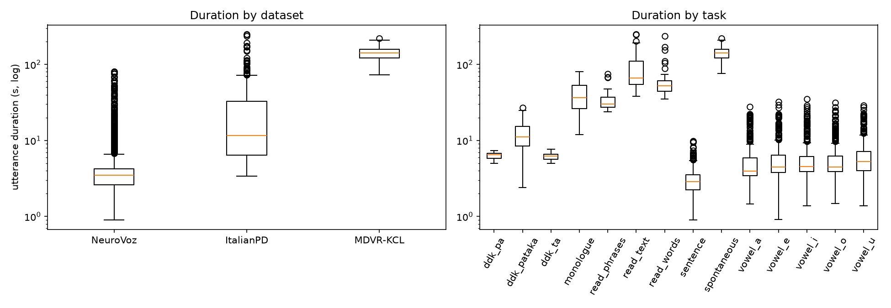
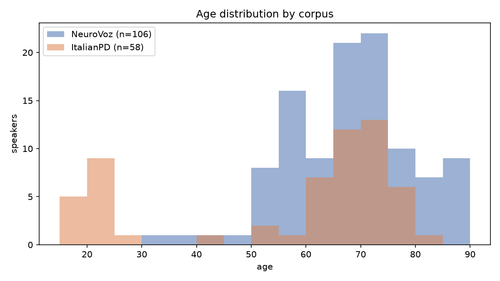
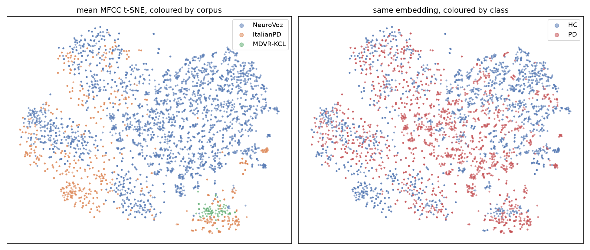

# Stage 2 — Exploratory analysis

DH307 Subtopic 4 · Corpus- and Language-Invariant Parkinson's Detection from Speech

This stage establishes the problem the project exists to solve, on this
project's own data, before anything is trained. It succeeds: **corpus identity
is far more linearly available in raw acoustics than the pathology is.** From
20 mean MFCCs, a speaker-disjoint logistic regression predicts which corpus a
file came from at 0.892 accuracy against a 0.767 majority-class baseline, but
reaches only 0.683 for PD versus HC against 0.500. Two further findings
constrain the experimental design: no raw task code exists in more than one
corpus, and the four *assigned* task families each span exactly two.

**In:** `data/manifests/manifest_processed.csv`
**Out:** `notebooks/eda_notes.md`, `notebooks/figures/`
**Code:** `scripts/eda.py`

---

## Class and domain balance

3871 files, 216 speakers, 12.26 hours.

| | HC | PD | total speakers | files | hours | median utterance |
|---|---|---|---|---|---|---|
| NeuroVoz | 58 | 56 | 114 | 2968 | 3.86 | 3.47 s |
| ItalianPD | 37 | 28 | 65 | 830 | 5.54 | 11.56 s |
| MDVR-KCL | 21 | 16 | 37 | 73 | 2.87 | 141.29 s |

Class balance is close to even in every corpus. Domain balance is not:
NeuroVoz supplies 77% of the files, while MDVR-KCL supplies 1.9% of the files
but 23% of the audio. Any domain head trained on files will be dominated by
NeuroVoz, which is why the pipeline calls for weighted cross-entropy on the
domain branch — and why segment-level rather than file-level counting matters
for MDVR-KCL, whose 73 files window into a large number of segments.



*Duration distributions, log scale. The corpora barely overlap: MDVR-KCL's
shortest recording is longer than almost everything in the other two.*

---

## Task availability

Raw task codes first:

| task | NeuroVoz | ItalianPD | MDVR-KCL |
|---|---|---|---|
| ddk_pa / ddk_ta | – | 50 / 50 | – |
| ddk_pataka | 101 | – | – |
| monologue | 76 | – | – |
| read_phrases | – | 47 | – |
| read_text | – | 123 | 37 |
| read_words | – | 65 | – |
| sentence | 1726 | – | – |
| spontaneous | – | – | 36 |
| vowel_a | 249 | 99 | – |
| vowel_e / i / o / u | 204 / 237 / 240 / 135 | 99 each | – |

**No raw task code is present in all three corpora.** Only `read_text` and the
vowels appear in more than one at all.

That framing is too pessimistic, though, because it treats corpus-specific
codes as if they were different tasks. Grouped into the four tasks the project
was actually assigned:

| assigned task | NeuroVoz | ItalianPD | MDVR-KCL |
|---|---|---|---|
| reading passage | – | 123 | 37 |
| phrases | 1726 | 47 | – |
| spontaneous | 76 | – | 36 |
| words | – | 65 | – |

**Each of the three multi-corpus families spans exactly two corpora**, and
those pairs differ in both language and channel, which is what makes them
usable for the cross-corpus question. 2110 of 3871 files fall into an assigned
family; the remaining 1761 are vowels and DDK.

Two consequences. First, no single task supports a three-way domain head, so a
task-matched DANN is inherently a two-domain experiment unless tasks are
pooled. Second, `words` exists only in ItalianPD and cannot support any
cross-corpus claim at all.

---

## Age

Coverage: NeuroVoz 106 of 114 speakers, ItalianPD 58 of 65, MDVR-KCL 0 of 37.
MDVR-KCL ships no age metadata at all, though Hoehn & Yahr and two UPDRS items
are encoded in its filenames.

| | n | mean | min | max |
|---|---|---|---|---|
| NeuroVoz HC | 53 | 64.0 | 31 | 86 |
| NeuroVoz PD | 53 | 71.1 | 41 | 88 |
| ItalianPD HC | 32 | 45.9 | 19 | 77 |
| ItalianPD PD | 26 | 67.0 | 40 | 80 |

ItalianPD by cohort: `young_control` n=15, mean 20.8 (19–29); `elderly_control`
n=17, mean 68.0 (60–77); `patient` n=26, mean 67.0 (40–80).

| | controls | controls under 50 | youngest patient |
|---|---|---|---|
| ItalianPD | 32 | 15 | 40 |
| NeuroVoz | 53 | 2 | 41 |

Age affects voice independently of pathology, so within ItalianPD a model can
separate the classes on age alone: 15 of its 32 controls are younger than any
patient in the corpus. NeuroVoz is effectively age-matched. Excluding
ItalianPD's `young_control` cohort — the remedy `README.md` proposes — is
therefore sufficient for the corpora now in scope, which was not true of the
four-corpus set. Stage 6 decided instead to keep the cohort and carry `cohort`
through the split files, having measured that exclusion changes ItalianPD
accuracy by less than half a point.

**The gap is MDVR-KCL.** With no age metadata whatsoever, its age balance
cannot be checked, so it cannot be ruled out as a confounded corpus — only
left unexamined. Since MDVR-KCL is the most likely leave-one-dataset-out target,
this is a caveat on the headline experiment rather than a minor omission.



*The young cluster in the orange ItalianPD distribution is its `young_control`
cohort. MDVR-KCL cannot be plotted.*

---

## Baseline t-SNE of mean MFCCs

The key deliverable. 20 MFCCs (n_fft 400, hop 160) averaged over time per file,
standardised globally, then t-SNE with perplexity 30, PCA init, seed 0.

Standardisation is global and never per corpus. Per-corpus statistics anywhere
in the feature path would leak exactly the information the adversary is meant
to remove; that invariant applies here as much as in training.



*Left: coloured by corpus, where MDVR-KCL and ItalianPD occupy their own
regions. Right: the same embedding coloured by class, where PD and HC are
thoroughly intermixed throughout.*

Quantitatively, with logistic regression on the same 20 features under 5-fold
speaker-disjoint GroupKFold:

| target | accuracy | majority-class baseline |
|---|---|---|
| which corpus | 0.892 ± 0.009 | 0.767 |
| PD vs HC | 0.683 ± 0.035 | 0.500 |

Corpus sits 12.5 points above its baseline; class sits 18.3 points above a much
lower one. The two numbers are not directly comparable as margins, which is why
the t-SNE geometry matters alongside them: the corpus structure is visible as
separated regions, while the class structure is not visible at all.

This reproduces the reference paper's motivating result on our own data and
becomes the reference point the DANN result is measured against.

**Caveat, which must accompany the figure.** Median utterance length ranges
from 3.5 s to 141.3 s, a 40-fold spread. A mean MFCC computed over two minutes
is a far smoother estimate than one computed over a three-second sentence, so
some of the measured separability is a duration artefact rather than a channel
effect. The conclusion survives — the separation is too clean, and 0.892 too
far above chance, to be explained by averaging alone — but the honest version
of the claim states it. Repeating this analysis on duration-matched segments
after Stage 4 would settle it, and that comparison is worth running.

---

## Findings worth carrying forward

1. No raw task code spans all three corpora, but each assigned task family
   spans two. Cross-corpus experiments are therefore two-domain per task, or
   three-domain with task pooled in — and in the second case a successful
   result cannot be attributed to channel or language invariance specifically,
   because task is confounded with domain.
2. The young-control age confound is confined to ItalianPD among the corpora
   now in scope, and excluding that cohort addresses it. MDVR-KCL's age balance
   is simply unknowable from the shipped metadata.
3. Corpus is far more linearly available than class. This is the premise of the
   project, now measured rather than assumed.

## Open items

- ~~Decide whether to exclude ItalianPD's `young_control` cohort, and regenerate
  splits accordingly at Stage 6.~~ **Decided at Stage 6: kept.** Excluding the
  cohort was measured to cost nothing (ItalianPD PD/HC 0.951 → 0.955 at utterance
  level), so it buys no accuracy, but the confound is real — young controls
  versus patients separates at 0.905 on age-correlated cues alone. `cohort` is
  carried in both split files so an elderly-only number can be reported without
  regenerating splits. See `reports/stage6_splits.md`.
- ~~Repeat the separability measurement on duration-matched segments once
  Stage 4 exists, to separate channel effect from averaging artefact.~~
  **Answered at Stage 5.** The `duration` level is fixed at 250 ms, so it is
  duration-matched by construction. Corpus separability there is 0.757 against
  0.938 at the utterance level, both against a 0.333 chance level. So a
  substantial part of the utterance-level corpus signal *was* an averaging
  artefact, as suspected here — but 0.757 on length-matched windows confirms a
  large genuine channel effect remains. The conclusion of this stage survives the
  correction.
- MDVR-KCL age remains unavailable; note it as a limitation in any LODO result.

## Reproduction

```bash
python scripts/eda.py     # mean MFCCs are cached to data/interim/mean_mfcc.npy
```
