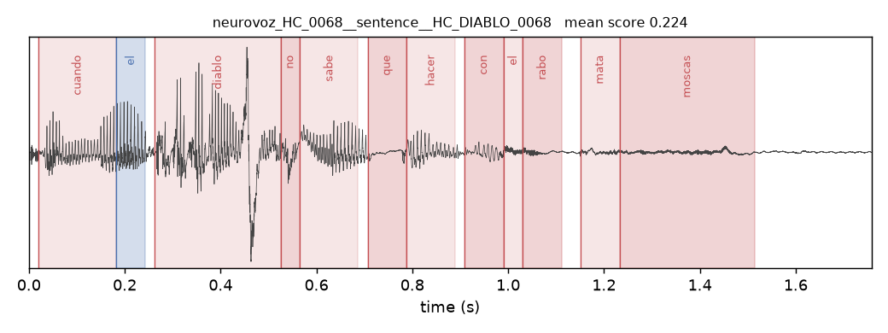
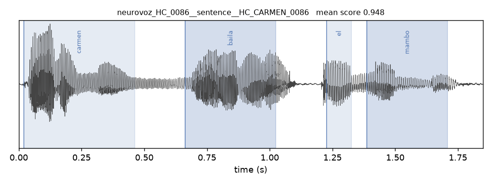

# Stage 3 — Forced alignment

DH307 Subtopic 4 · Corpus- and Language-Invariant Parkinson's Detection from Speech

Word- and character-level boundaries were produced with one multilingual CTC
aligner for every language. The first pass covered **1867 NeuroVoz + ItalianPD
`read_words` files** (100% success, 16 rejects). A follow-up sourced the
remaining scripted prompts and ran local Whisper on MDVR-KCL spontaneous,
leaving **2101 aligned files and 38 rejects (1.8%)**. MDVR-KCL word-level work
is the 35 accepted **read passages**, not the dialogues; phoneme-level work is
still Spanish and Italian only.

**In:** `data/manifests/manifest_processed.csv`, `configs/prompts.yaml`
**Out:** `data/interim/alignments/<dataset>/*.json`,
`data/interim/alignment_index.csv`, `data/interim/alignment_rejects.csv`
**Code:** `src/data/transcripts.py`, `src/data/align.py`,
`scripts/inspect_alignments.py`

---

## The transcript decision

Forced alignment needs a transcript, and the corpora supply them unevenly.
`src/data/transcripts.py` resolves each utterance to one of four sources:

| source | meaning | files |
|---|---|---|
| `per_file` | verbatim transcript shipped with the corpus | 1802 (NeuroVoz) |
| `prompt` | canonical task text from `configs/prompts.yaml` | 272 (ItalianPD all read tasks + MDVR-KCL `read_text`) |
| `asr` | local Whisper `small.en` | 36 (MDVR-KCL `spontaneous`) |
| `missing` | no transcript exists | 0 |

Of 3871 processed files, 2110 carry lexical content at all; sustained vowels and
DDK are excluded here by definition, since they have no words to align.

**Decision taken: align scripted tasks from published text; ASR only where it
is cheap and English-only.** The original default was “align only what already
has text,” which left 243 files (all of MDVR-KCL plus two ItalianPD tasks)
unaligned. Those scripted prompts were later sourced from the papers; Whisper
`small.en` was run on the 36 MDVR-KCL dialogues because that job is small and
does not introduce a *cross-language* ASR-error confound. The dialogues still
fail as word-level material — see the follow-up below.

The argument against ASR-as-coverage remains: a multilingual ASR whose error
rate differs by language would encode domain in the boundaries. That is not
what was run.

Consequences to carry into Stage 4 onwards:

- Phoneme level covers NeuroVoz and ItalianPD only. English MMS characters are
  not a phone set, so MDVR-KCL has no phoneme segments.
- Word level covers all three corpora, but MDVR-KCL only via the 35 accepted
  North Wind readings. Spontaneous ASR is not used.
- `read_words` alignment exists only for ItalianPD, so the `words` task
  supports no cross-corpus claim.

`transcripts.csv` carries a `source` label (`per_file` / `prompt` / `asr` /
`missing`). Flag `source=asr` in any claim that touches those rows.

### Prompts (now sourced)

ItalianPD `read_text` is *Il ramarro della zia* and `read_phrases` are the ten
FB1 sentences, both from Dimauro et al., IEEE Access 2017. MDVR-KCL
`read_text` is North Wind and the Sun from the Zenodo 2867216 appendix; the
aligner also tries the geography-snippet extension and keeps the higher score
(every file preferred the short prompt). ItalianPD `read_words` was already
recovered from the corpus PR1 scoring sheet.

---

## Aligner

`torchaudio.pipelines.MMS_FA`, a wav2vec2-large multilingual CTC model, run as a
single aligner across all languages. A per-language aligner would be more
accurate on any one corpus, but its error profile would then differ by corpus,
reintroducing domain signal. Consistency is worth more here than peak accuracy
on any single language.

Two implementation notes. Text is folded to the model's 29-character vocabulary
by stripping combining marks rather than dropping accented characters, so
*mañana* becomes *manana* and keeps all six characters instead of losing one.
Audio is read with `soundfile` rather than `torchaudio.load`, because torchaudio
2.11 routes loading through TorchCodec, an extra native dependency that buys
nothing for 16 kHz mono PCM.

### Running it on 4 GB

The first attempt at NeuroVoz failed hard: 425 files aligned, then
`CUDA error: out of memory` for the remaining 1377, because the run had no
fallback and a fragmented allocator never recovered. The rewritten `Backend`
routes long utterances to CPU above a threshold, catches OOM per file, calls
`empty_cache()` and retries on CPU, and counts both events for the run summary.

Measuring the threshold changed the plan. At `--gpu-max-seconds 30`, the 114
files over 30 s carry 53% of the alignable audio and all went to CPU, giving
3.3x realtime. At 300 s nothing fell back, and throughput rose to 20–60x
realtime. The allocator does emit `memory allocation failed with OOM` warnings
while doing this, but they are warnings: PyTorch frees cached blocks and retries
internally, and no file failed. The distinction matters — those lines look like
the earlier fatal error and are not.

The whole job runs in **3.3 minutes on an RTX 3050 Laptop (4 GB)**, so the KCDH
server was not needed for this stage. `--resume` skips files already aligned
successfully and retries failures, so a long run is restartable.

---

## Results

| | files | words | success | mean word score |
|---|---|---|---|---|
| NeuroVoz `sentence` | 1726 | 18,029 total | 100% | 0.900 (corpus) |
| NeuroVoz `monologue` | 76 | (as above) | 100% | – |
| ItalianPD `read_words` | 65 | 3,250 | 100% | 0.911 |

No file failed for any reason: 1867 of 1867 aligned.

Quality, over all aligned files:

| | NeuroVoz | ItalianPD |
|---|---|---|
| median word confidence | 0.981 | 0.981 |
| words scoring under 0.5 | 7.43% | 3.14% |
| words under 30 ms | 6.30% | 0.00% |
| median coverage (aligned span / duration) | 0.895 | 0.977 |
| files covering under 50% of audio | 34 | 0 |

**ItalianPD aligns better than NeuroVoz despite using a generic prompt rather
than a per-file transcript** — 0.911 against 0.900 mean score, with no floored
words and near-total coverage. The explanation is task structure, not transcript
quality: reading a 50-word list produces isolated words separated by pauses,
which is the easiest possible alignment target, whereas NeuroVoz sentences are
short connected utterances where a single misplaced boundary moves several
words.

---

## Rejection list

`data/interim/alignment_rejects.csv`, 16 files (0.9%). One criterion only:
**mean word score below 0.5**, meaning the aligner is not confident about the
file as a whole.

| | rejected |
|---|---|
| NeuroVoz `sentence` | 13 |
| NeuroVoz `monologue` | 2 |
| ItalianPD `read_words` | 1 |

Two further criteria were tried and discarded, both because they turned out to
flag properties of the *prompt* rather than defects in the *recording*. Both are
kept as diagnostic columns.

**Implied speaking rate.** 31 files exceed 4 words/s, which looks physically
implausible, but several of them score 0.96 and align cleanly: Spanish
sentences built from short function words genuinely run that fast.

**Share of words pinned to the 30 ms floor.** This one was more tempting — it
reads as "words crammed into audio that does not contain them" — and at a 20%
threshold it flagged 13 files. But 10 of those 13 score above 0.8, and **9 of
the 13 are the same sentence**, `PIDIO`: *no pidas a quien pidió, y no sirvas a
quien sirvió*. Its three one-letter words are elided in connected speech, and
the aligner assigns them ~20 ms at score 0.99, which is correct:

```
no     0.10 - 0.20   100 ms  score 0.999
pidas  0.28 - 0.60   321 ms  score 0.998
a      0.66 - 0.68    20 ms  score 0.998
quien  0.76 - 0.94   180 ms  score 0.800
...
y      2.27 - 2.29    20 ms  score 0.996
```

Rejecting whole files on this basis would have thrown away eight good word
segments to remove three questionable ones, and would have done so
systematically for one sentence — biasing the word-level dataset by prompt.
Very short words are a word-level problem, handled by the minimum segment
duration in Stage 4, not a reason to discard a file.

### What the rejects actually are

The worst file in the set, `HC_DIABLO_0068`, is a 1.76 s recording carrying a
12-word transcript (*cuando el diablo no sabe qué hacer con el rabo mata
moscas*), and only the first 0.7 s contains speech at all.



*Twelve words distributed across audio that contains perhaps three. The red
shading marks words scoring under 0.5.*

This is the same defect as the eight files blacklisted in Stage 1 — a recording
truncated before the speaker finished the prompt — but long enough to pass a
duration filter. **Alignment confidence turns out to be a better detector of
truncated recordings than duration is**, and the eight Stage 1 exclusions were
evidently the visible tail of a larger problem rather than the whole of it.

For contrast, a median-scoring file places four words on four energy bursts:



---

## What survives, and what Stage 4 must decide

After rejection: **1851 files, 21,006 words, 19,586 word segments at or above
50 ms.**

| | files | word segments (≥50 ms) | median segment |
|---|---|---|---|
| NeuroVoz `sentence` | 1713 | 11,019 | 242 ms |
| NeuroVoz `monologue` | 74 | 5,367 | 200 ms |
| ItalianPD `read_words` | 64 | 3,200 | 460 ms |

**A minimum segment duration is not optional.** Even in accepted files, 6.8% of
words are shorter than 50 ms and 14.1% shorter than 80 ms. A 20 ms "word" is a
boundary artefact, not a word, and at 16 kHz it is 320 samples — too short for
the 25 ms analysis windows Stage 5 plans to use. The 50 ms floor above is a
starting point, not a settled choice.

**Word spans can absorb long pauses in the word-reading task.** ItalianPD word
durations reach 14.98 s against a 95th percentile of 0.94 s, because a silent
gap between list items gets attached to the preceding word. Word segments from
that task need an upper bound or silence trimming, not just a lower bound.

**MMS_FA emits characters, not phones.** The JSON carries per-character spans,
which for Spanish and Italian approximate phones closely because the
orthography is shallow. Phoneme-level segmentation, and the question of whether
to map onto a shared cross-language phonetic class scheme, is Stage 4 work and
is where the character-versus-phone gap has to be confronted.

---

## Follow-up — prompts, ASR, MDVR-KCL

The three unsourced prompts were filled from the published texts and aligned.
Whisper `small.en` (MIT, local, ~7 min on the 4 GB card) transcribed the 36
MDVR-KCL spontaneous files. Costantini et al. (Sensors 2024) diarized this
corpus in MATLAB and did not release timestamps; pyannote is gated. Diarization
was skipped.

| | files | mean word score | rejected (score &lt; 0.5) |
|---|---|---|---|
| ItalianPD `read_text` | 123 / 123 | 0.911 | 1 |
| ItalianPD `read_phrases` | 47 / 47 | 0.929 | 0 |
| MDVR-KCL `read_text` | 37 / 37 | 0.807 | 2 |
| MDVR-KCL `spontaneous` (ASR) | 27 / 36 aligned | 0.381 | 19 of the 27 |

Scripted prompts behave like the rest of Stage 3. ASR spontaneous does not:
mean score 0.381, 19 of 27 aligned files rejected, 9 more failed CTC
(`targets contain blank index` — Whisper transcripts are too long for the
emission, including interviewer speech). Those rows stay `source: asr` and
are not used at word/phoneme level. MDVR-KCL word-level work is therefore
the 35 accepted read passages, not the dialogues.

MDVR-KCL `read_text` tries North Wind alone and North Wind plus the geography
snippet; every file scored higher on the short prompt. Apostrophes had to be
stripped before MMS_FA (`observer's` maps onto the CTC blank).

The 34 low-coverage NeuroVoz files were left as they are.

After this pass: **2101 aligned files, 38 rejects (1.8%)**.

## Open items

- MDVR-KCL spontaneous remains unused at word/phoneme level. Diarize-then-ASR
  would be required to change that; previous work did not release the cuts.

## Reproduction

```bash
python -m src.data.transcripts
python -m src.data.asr --dataset MDVR-KCL --task spontaneous
python -m src.data.transcripts
python -m src.data.align --dataset NeuroVoz  --device cuda --gpu-max-seconds 300 --resume
python -m src.data.align --dataset ItalianPD --device cuda --gpu-max-seconds 300 --resume
python -m src.data.align --dataset MDVR-KCL  --device cuda --gpu-max-seconds 300 --resume
python scripts/inspect_alignments.py --n 12
```
